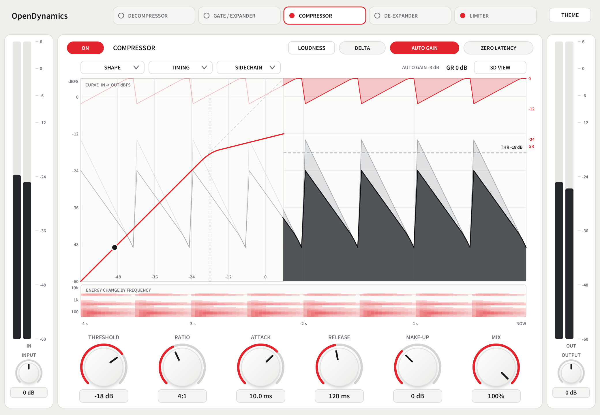
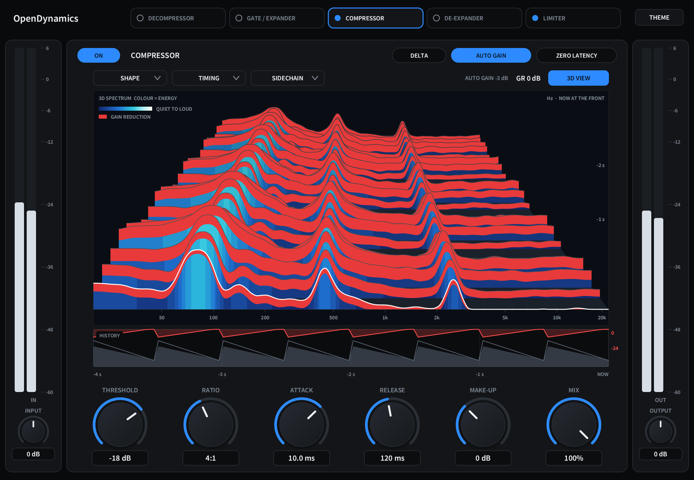
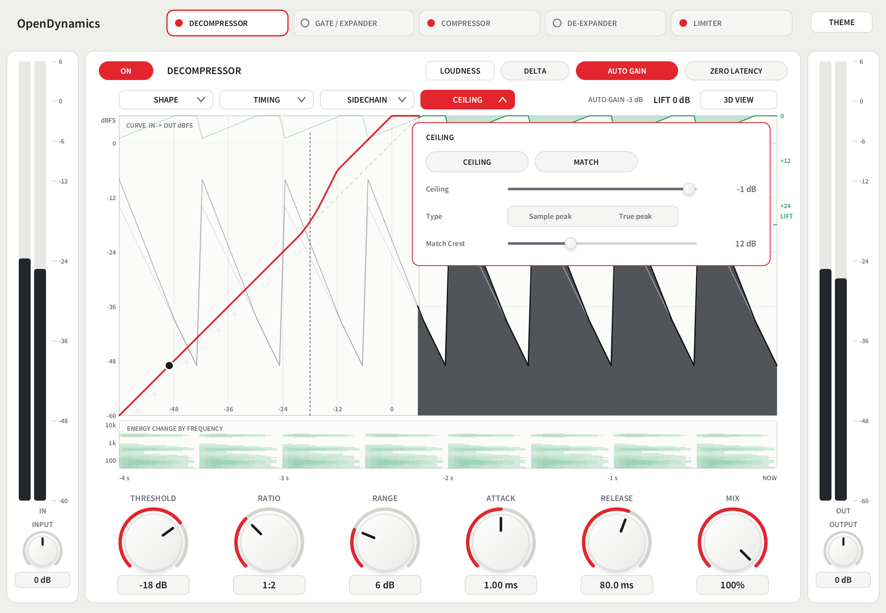
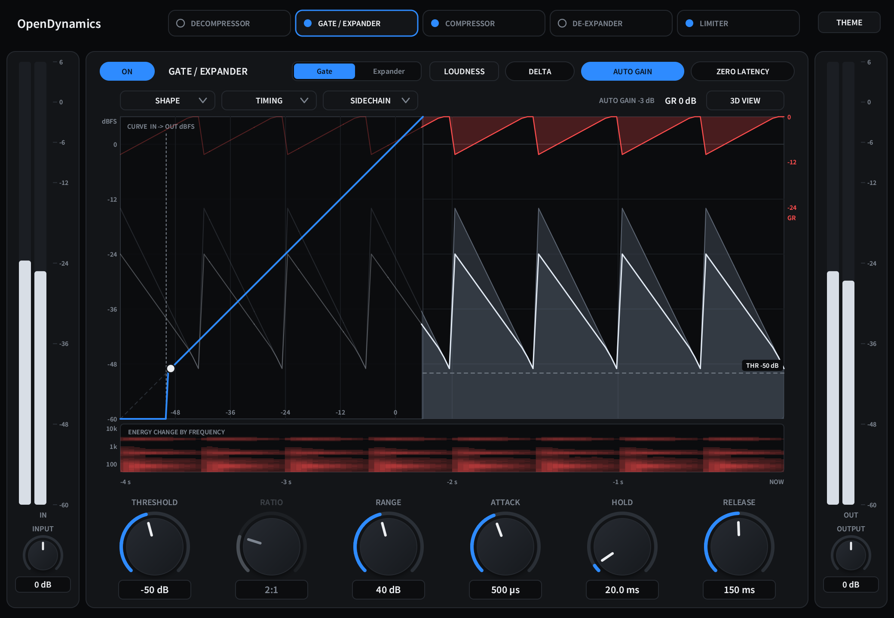
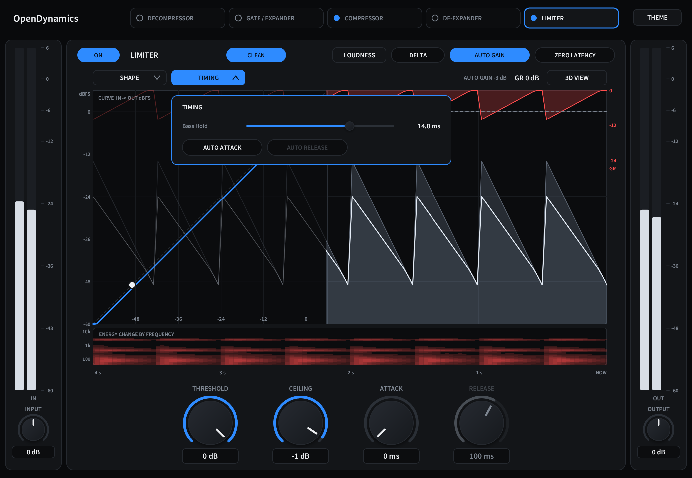

# OpenDynamics

**A five-section dynamics processor with real static curves: a steady tone passes through it without added harmonics.**
By OpenGrid.



| 3D spectrum | Decompressor ceiling | Gate / Expander | Limiter timing |
|---|---|---|---|
|  |  |  |  |

## Version 1.0.0 Beta

- Decompressor, Gate / Expander, Compressor, De-Expander and Limiter in one plugin, in that order.
- Look-ahead that lands the gain on a transient's first sample, or Zero Latency; auto attack and release everywhere.
- Sidechain filter on every keyed section: internal or external key through high-pass, low-pass and bell at once.
- Limiter Clean mode, Auto Gain and Delta listening aids.
- Curve inside a level history, energy change by frequency, 3D spectrum view, seven themes.

## Download

From the [1.0.0 Beta release](https://github.com/MistaMin/OpenDynamics/releases/tag/v1.0.0-Beta) (a pre-release):

| Download | System | Formats |
|---|---|---|
| [`OpenDynamics-1.0.0-Beta-macos.pkg`](https://github.com/MistaMin/OpenDynamics/releases/download/v1.0.0-Beta/OpenDynamics-1.0.0-Beta-macos.pkg) | macOS 11 or later, Apple silicon and Intel | VST3, Audio Unit, CLAP, LV2, AAX |
| [`OpenDynamics-1.0.0-Beta-windows-x64-setup.exe`](https://github.com/MistaMin/OpenDynamics/releases/download/v1.0.0-Beta/OpenDynamics-1.0.0-Beta-windows-x64-setup.exe) | Windows 10 or later, x64 | VST3, CLAP, LV2 |
| [`OpenDynamics-1.0.0-Beta-linux-x86_64.tar.gz`](https://github.com/MistaMin/OpenDynamics/releases/download/v1.0.0-Beta/OpenDynamics-1.0.0-Beta-linux-x86_64.tar.gz) | Linux x86_64 | VST3, CLAP, LV2 |

The macOS installer is signed with Developer ID and notarized by Apple; the AAX is signed with PACE Eden. The Windows
installer is not code-signed, so SmartScreen may ask before it runs. The Windows and Linux builds are made by GitHub
Actions and have passed the automated tests only, not a host. No standalone app.

## User guide

- [User manual](docs/USER_MANUAL.md) (PDF in each release) and [parameter reference](docs/PARAMETERS.md)
- [Changelog](CHANGELOG.md) and [release notes](RELEASE_NOTES.md)

## Sections (in signal order)

| Section | What it does |
|---|---|
| Decompressor | Upward expansion above a threshold: restores transients that earlier compression flattened. Optional sample- or true-peak ceiling and crest matching |
| Gate / Expander | Gate with range, hysteresis and hold, or a downward expander with ratio and knee |
| Compressor | Feed-forward, soft knee centred on the threshold, exact ratio, make-up and mix |
| De-Expander | Upward compression of quiet passages below a threshold, above a floor |
| Limiter | Simple peak limiter, no look-ahead, zero latency. Clean mode holds the reduction over bass cycles and sets the release from the programme's crest factor |

Every section has look-ahead (the gain glides into place and lands on the transient's first
sample), auto attack and auto release, and a sidechain filter: internal or external key through a
high-pass, a low-pass and a bell band at once.

Global: input and output gain, Zero Latency (drops every look-ahead), Auto Gain (matches the output
loudness to the input, a listening aid) and Delta (plays only what the sections changed).

The editor shows the static curve inside a four-second level history, a spectrograph of the energy
each band lost or gained, and a 3D spectrum view over the full band. Seven colour themes.

## Build from source

Rust (stable). The project builds against OpenPluginSDK checked out next to it
(`../../Dependencies/OpenPluginSDK`), which carries GoodLookin DRI in its tree.

```bash
cargo test --release --workspace   # DSP, plugin and editor tests
./scripts/build.sh                 # macOS bundles into dist/ (needs the VST3, AU and AAX SDKs)
```

Windows and Linux builds, their installer and archive, run in GitHub Actions (`.github/workflows/build.yml`).
`scripts/make_installer.sh` makes the signed macOS installer; `tools/build_user_manual.py` the manual PDF.

| Folder | Contents |
|---|---|
| `src/` | the plugin: parameters, chain, Auto Gain, Delta, editor (`src/ui/`) |
| `crates/` | the sections' DSP (`dynamics`: gate, compressor, limiter; `dyn-decompress`; `dyn-deexpand`) |
| `docs/` | manual, parameter reference, pictures |
| `installer/`, `scripts/`, `tools/` | Windows installer, build and macOS installer scripts, manual and manifest tools |
| `qa/` | test evidence |

## License

Source code: MIT, see [LICENSE](LICENSE). Copyright (c) 2026 Marcos Quirino Deida. The official binaries are freeware
under [BINARY_LICENSE.txt](BINARY_LICENSE.txt). Third-party components: [THIRD_PARTY_LICENSES.md](THIRD_PARTY_LICENSES.md).

VST is a trademark of Steinberg Media Technologies GmbH. Audio Units is a trademark of Apple Inc. AAX and Pro Tools are
trademarks of Avid Technology, Inc.
