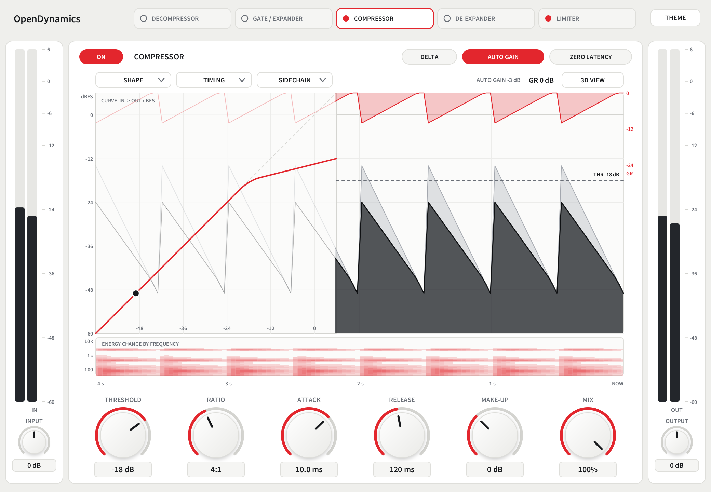
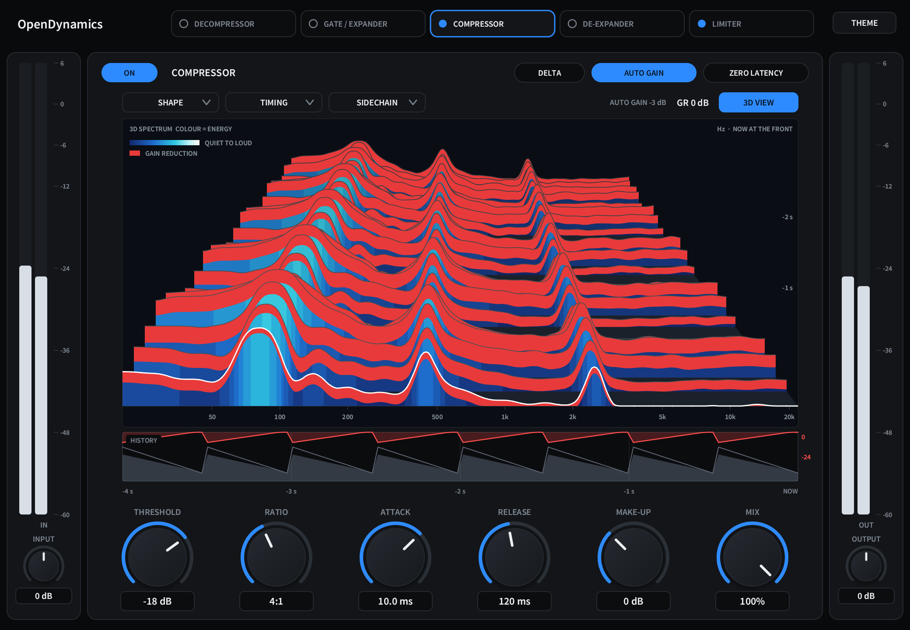
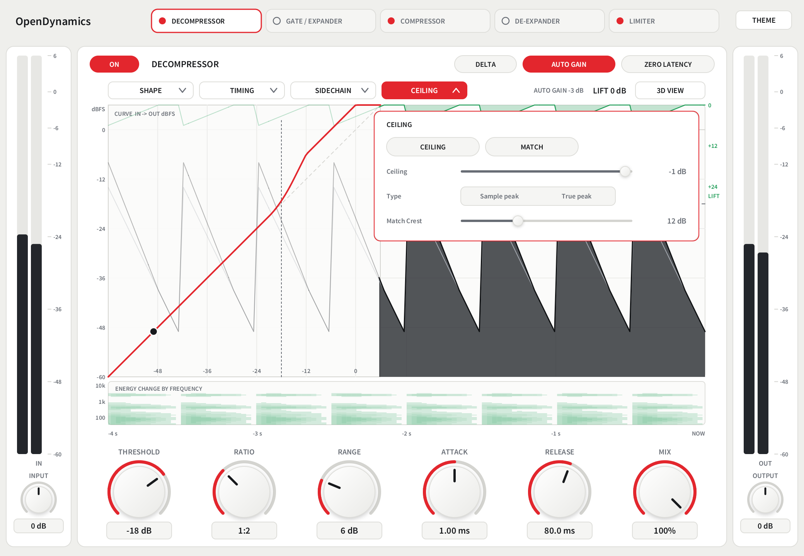
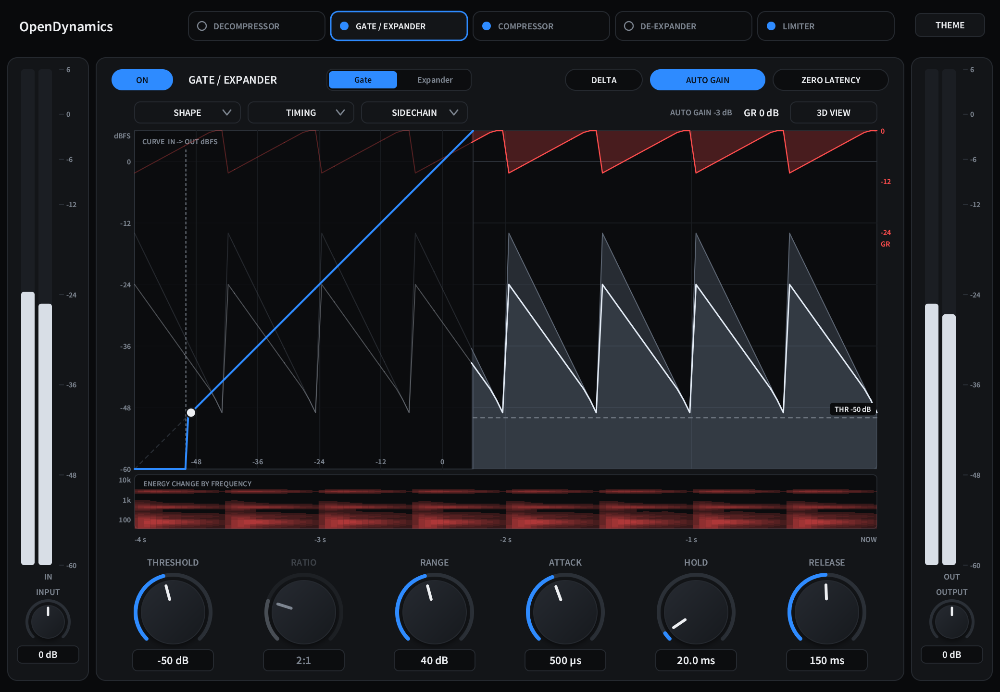
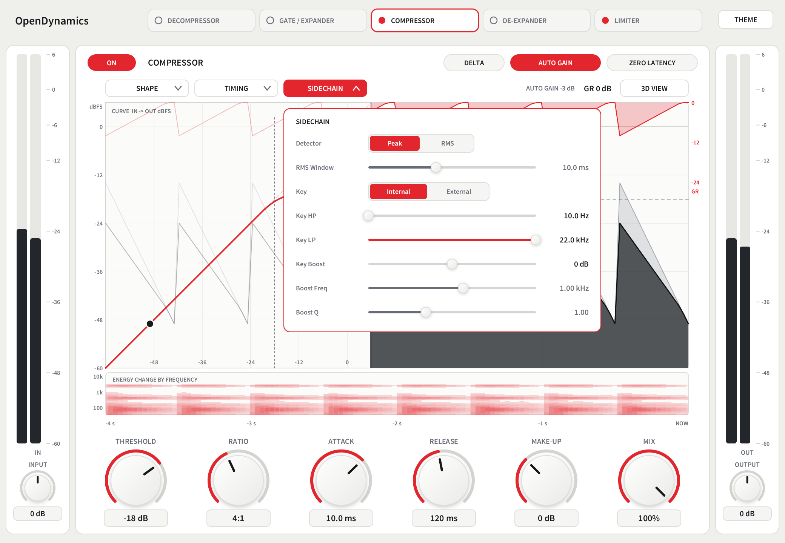
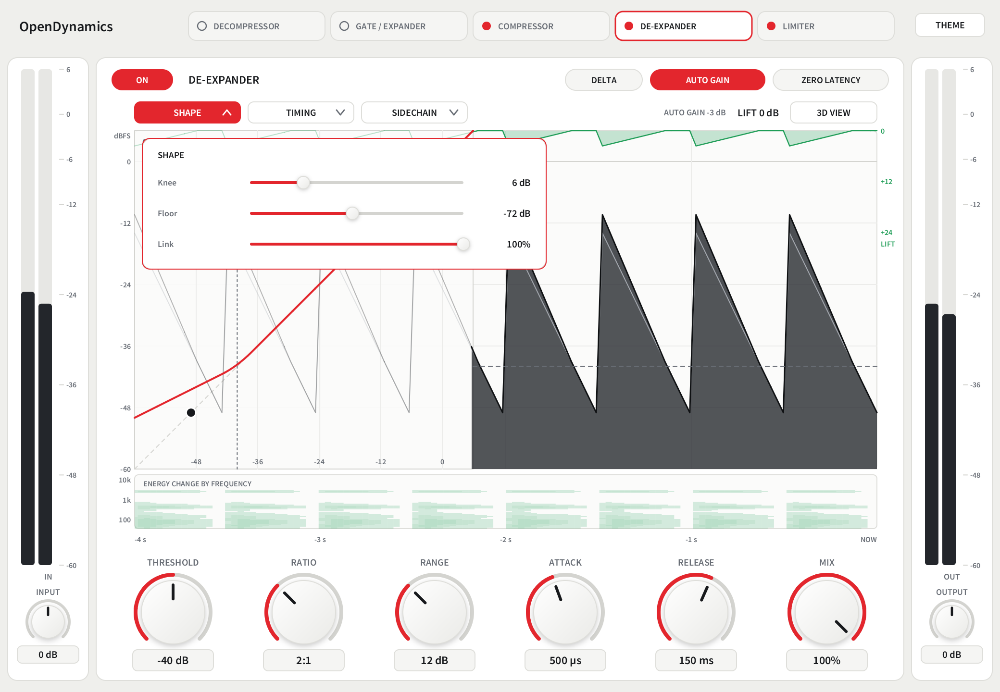
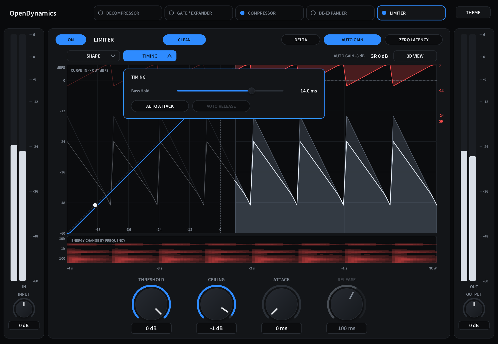

# OpenDynamics User Manual

OpenDynamics is a dynamics processor by OpenGrid: five sections in one plugin, each a pure gain stage with a real static
curve. A steady tone passes through it without added harmonics; only its level changes.

## Signal flow

The sections run in this order. Each has its own tab and its own On switch; a section that is off passes the signal
untouched.

| Order | Section | What it does |
|---|---|---|
| 1 | Decompressor | Upward expansion above the threshold: brings back transients that earlier compression flattened. Optional sample- or true-peak ceiling and crest matching |
| 2 | Gate / Expander | A gate with range, hysteresis and hold, or a downward expander with ratio and knee |
| 3 | Compressor | Feed-forward compression, soft knee centred on the threshold, exact ratio, make-up and mix |
| 4 | De-Expander | Upward compression of quiet passages below the threshold, above a floor |
| 5 | Limiter | A peak limiter. Clean mode holds the reduction over bass cycles and sets the release from the programme's crest factor |

New instances start with the Compressor and the Limiter on.

## The window

- **Tabs** along the top select a section. The dot on a tab is lit when that section is on.
- **Input and output** strips on the left and right: level meters and the Input Gain and Output Gain knobs (-24 to 24 dB).
- **Section bar:** the section's ON switch and the global DELTA, AUTO GAIN and ZERO LATENCY switches.
- **Panels:** SHAPE, TIMING, SIDECHAIN (and CEILING on the Decompressor) open sliders for the less frequent controls. Click
  the panel's button again, or elsewhere, to close it.
- **Readouts:** the current gain reduction (GR) and, while Auto Gain is on, the gain it applies.
- **Display:** the static curve (input level against output level, with a dot at the present level) inside a four-second
  history of the input, the output and the gain reduction. Below it, **Energy change by frequency** shows, band by band,
  how much energy the section removed (red) or added.
- **3D VIEW** turns the display into a 3D spectrum of the full band (20 Hz to 20 kHz) over the last seconds, newest at
  the front. Colour shows energy, from quiet to loud; gain reduction is drawn in one fixed red. The history moves to the
  lane below.
- **Main knobs** along the bottom: the section's most used controls.
- **THEME** switches between seven colour themes: Light, Dark, Graphite, Paper, Slate, Neon and Rosé.

Values show in whole dB and whole ratios. Times below 1 ms show in microseconds, frequencies from 1000 Hz in kHz. You
can type a value into a host's parameter field in the same form (`-18 dB`, `4:1`, `500 µs` or `500 us`, `2.5 kHz`).

## Global controls

| Control | What it does |
|---|---|
| Input Gain, Output Gain | Level into and out of the chain, -24 to 24 dB |
| Zero Latency | Drops every section's look-ahead, so the plugin reports no latency. Sections then react from the first sample of a peak instead of landing on it |
| Auto Gain | Matches the output loudness to the input (BS.1770 weighting, three-second average, up to ±24 dB), so you hear the processing, not the level change. A listening aid: switch it off before you print |
| Delta | Plays only what the sections changed: the output minus the latency-aligned input. Switch it off before you print |

## Controls common to every section

| Control | What it does |
|---|---|
| Threshold | The level where the section starts to act |
| Ratio | The slope of the curve beyond the threshold |
| Knee | The width in dB of the soft knee, centred on the threshold |
| Attack, Release | How fast the gain moves towards more and less reduction |
| Auto Attack, Auto Release | Adapt attack and release to the programme: faster on short peaks, slower on sustained material |
| Look-Ahead | Delays the audio so the gain is in place on a transient's first sample. Adds latency; ignored under Zero Latency |
| Stereo Link | 100% acts on both channels together, 0% on each channel by itself |
| Detector | Peak or RMS (and Transient on the Decompressor) |
| RMS Window | The averaging time of the RMS detector |
| Key | Internal (the section's own input) or External (the plugin's sidechain input) |
| Key HP, Key LP | High-pass and low-pass filters on the key signal |
| Key Boost, Boost Freq, Boost Q | A bell on the key signal, to make the section listen more (or less) to one frequency range. HP, LP and the bell work at the same time |
| Mix | Blends the processed signal with the dry signal (where the section has it) |

The external key is available where the host offers a sidechain input to the plugin.

## Decompressor

Raises the level above the threshold by the ratio 1:x (1:2 doubles the distance above the threshold in dB), up to
**Range**. With the **Transient** detector the threshold rides **Crest** dB above the programme's body (its slow RMS
level), so the section lifts the attacks that stand out from the body and leaves sustained notes. **Output Trim** lowers the result.

The CEILING panel:

- **Ceiling** on: the output never passes **Ceiling Level**, measured as **Sample peak** or **True peak**.
- **Match** on: the section sets its own amount so the programme's crest factor reaches **Match Crest**.

## Gate / Expander

**Mode** Gate closes by up to **Range** when the level falls below the threshold; **Hysteresis** opens it a few dB
higher than it closes, and **Hold** keeps it open for a time after the level falls. **Mode** Expander lowers quiet
passages by the ratio, with a knee, also limited by Range.

## Compressor

Feed-forward compression with an exact ratio above the knee. **Make-Up** raises the output after compression; **Mix**
gives parallel compression.

## De-Expander

Raises quiet passages below the threshold towards it, by the ratio, by up to **Range**. Material at or below **Floor** (noise,
room tone) is not raised.

## Limiter

A peak limiter that keeps the output under **Ceiling**; **Threshold** sets how hard the signal is pushed into it.
**Clean** (on by default) holds the gain over a whole bass cycle (up to **Bass Hold**) so low notes are not distorted by
the gain moving inside the waveform, and sets the release from the programme's crest factor. With Clean on, the release
is always automatic; Release and Auto Release apply with Clean off.

## Formats and hosts

- macOS 11 or later, Apple silicon and Intel: VST3, Audio Unit, CLAP, LV2 and AAX (Pro Tools).
- Windows 10 or later, x64: VST3, CLAP and LV2.
- Linux x86_64: VST3, CLAP and LV2.

## Licence

Every parameter with its range and default is listed in the parameter reference that follows (`docs/PARAMETERS.md`).

The source code is MIT licensed. The official binaries are freeware under `BINARY_LICENSE.txt`. Third-party components
and their licences are listed in `THIRD_PARTY_LICENSES.md`. Copyright (c) 2026 Marcos Quirino Deida.

VST is a trademark of Steinberg Media Technologies GmbH. Audio Units is a trademark of Apple Inc. AAX and Pro Tools are
trademarks of Avid Technology, Inc.
